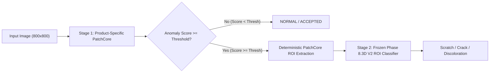
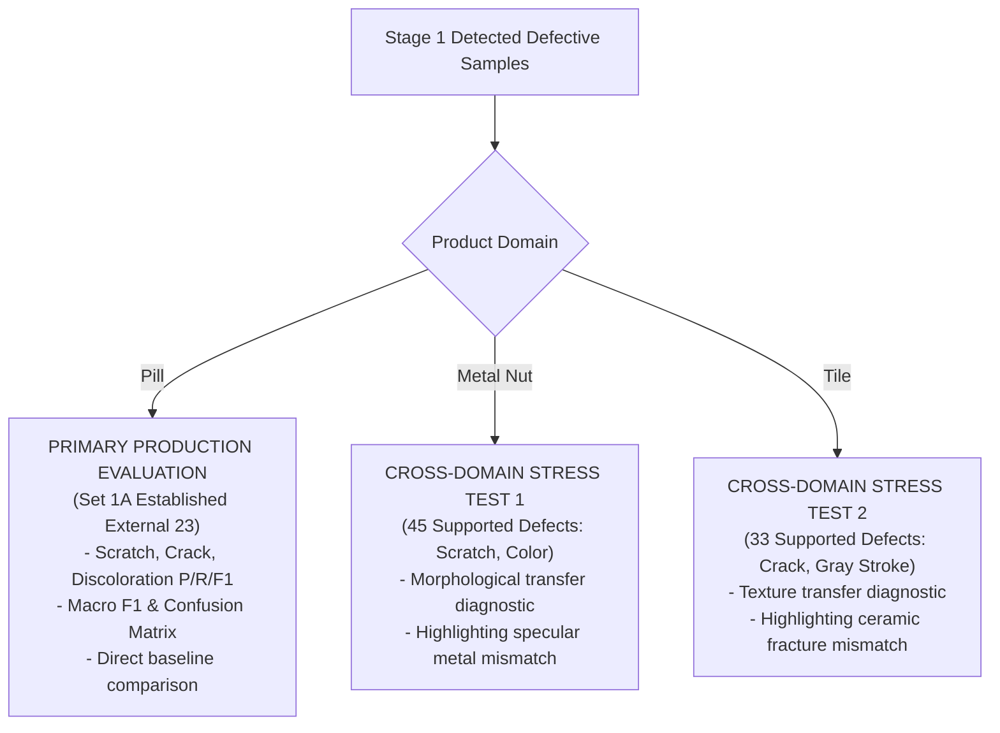
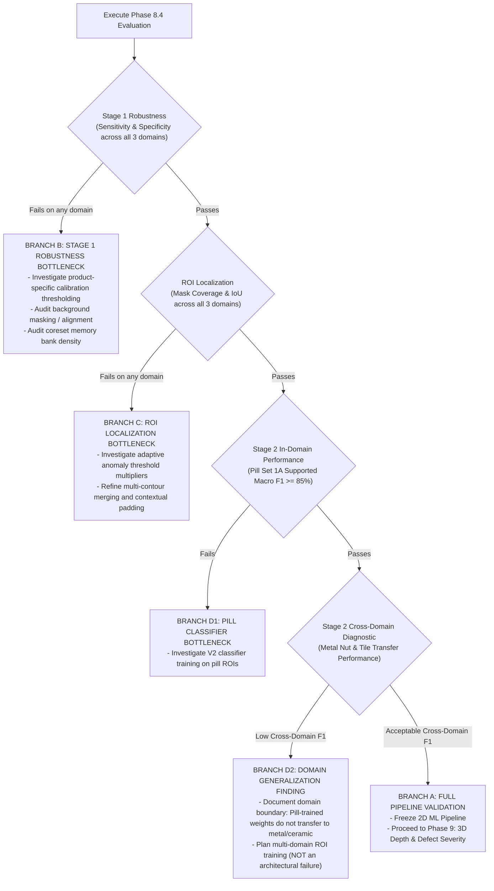

# PHASE 8.4: SYSTEM-LEVEL EVALUATION DESIGN REPORT (REVISED)

> **CLASSIFICATION**: SYSTEM-LEVEL EVALUATION DESIGN ONLY  
> **STATUS**: PRODUCTION CODE, MODELS, DATABASE, CALIBRATION ARTIFACTS, AND FRONTEND REMAIN **100% STRICTLY FROZEN**.  
> **EXECUTION NOTICE**: THIS IS A DESIGN SPECIFICATION ONLY. NO EVALUATION RUN, BENCHMARKING SCRIPT, OR MODEL RETRAINING IS PERFORMED IN THIS PHASE.  
> **DATE**: 2026-10-07 (Revised Design)  
> **TARGET DIRECTORY**: `experiments/system_evaluation_design/`

---

## 1. EXECUTIVE SUMMARY & OBJECTIVE

### Current Frozen Production 2D Pipeline


### Context & Goal of Phase 8.4
In Phase 8.3, extensive offline ML diagnostic audits (8.3A through 8.3F) evaluated the 2D pipeline on the **MVTec pill** domain:
- **Phase 8.3B** identified that full-image Stage 2 classification suffered severe domain mismatch (43.5% accuracy), driven by global normal features drowning out localized defects.
- **Phase 8.3C & 8.3D** proved that **PatchCore-guided localized ROIs** resolved this bottleneck, boosting Stage 2 classification accuracy to **91.30% (21/23)** and macro F1 to **0.9131** on the established external pill benchmark.
- **Phase 8.3E & 8.3F** proved that **open-set rejection** (`UNKNOWN`) cannot reliably separate unsupported pill defects (`faulty_imprint`, `contamination`, `combined`) from supported defects using post-hoc gating or contrastive representation learning in low-data regimes. Open-set rejection remains frozen out of production.

**The Purpose of Phase 8.4** is to design a comprehensive, standardized, system-level evaluation to test whether the current complete 2D production pipeline is good enough across **representative industrial products and material domains**, and to systematically identify the real system bottleneck if it is not.

This phase is **DESIGN ONLY**. No models will be retrained, no thresholds will be modified, and no evaluation runs will be executed.

---

## 2. STAGE 2 DOMAIN SCOPE: PRIMARY EVALUATION VS CROSS-DOMAIN STRESS TEST

A critical design principle of this evaluation is the strict distinction between **intended-domain evaluation** and **cross-domain stress testing**:

```
+-----------------------------------------------------------------------------------+
|                        STAGE 2 DOMAIN SCOPE SPECIFICATION                         |
+-----------------------------------------------------------------------------------+
|  A. PRIMARY PRODUCTION EVALUATION (Intended Domain)                               |
|     - Target: Pill supported defects (Scratch, Crack, Discoloration)               |
|     - Purpose: Validate production classifier on the domain it was trained for.    |
|     - Interpretation: Fair test of classifier performance and production fitness. |
+-----------------------------------------------------------------------------------+
|  B. CROSS-DOMAIN STRESS TEST (Domain-Mismatch Diagnostic)                         |
|     - Target: Metal Nut (Scratch, Color) and Tile (Crack, Gray Stroke)            |
|     - Purpose: Diagnostic probe of zero-shot feature transfer across materials.   |
|     - Interpretation: Domain-mismatch stress test ONLY.                           |
|       * Poor performance is expected and reflects training data domain coverage.  |
|       * MUST NOT be interpreted as failure of classifier architecture.            |
+-----------------------------------------------------------------------------------+
```

1. **Primary Production Classifier Evaluation (Intended Domain)**:
   - The frozen Phase 8.3D V2 ROI classifier was trained specifically on **pill ROI data**.
   - Evaluating this classifier on the pill supported-defect benchmark (`Scratch`, `Crack`, `Discoloration`) constitutes the primary test of production readiness.
2. **Cross-Domain Stress Test (Diagnostic Only)**:
   - Passing Metal Nut and Tile ROIs through the pill-trained V2 classifier is a **cross-domain stress test / domain-mismatch diagnostic**.
   - Because the classifier has never observed metallic machining marks, specular highlights, or ceramic glaze textures during training, domain shift is inevitable.
   - Cross-domain results must be reported as diagnostic transfer evidence. Poor cross-domain results must **NOT** be used as evidence that the ResNet-18 ROI classifier architecture itself is inadequate.

---

## 3. PRODUCT & MATERIAL DOMAIN SELECTION

To evaluate whether the Stage 1 anomaly detector and the overall pipeline structure generalize beyond compressed powder pharmaceutical tablets, we select **three representative product/material domains** directly from the authoritative dataset manifest (`manifests/dataset_manifest.jsonl`).

### Domain Comparison Matrix

| Attribute | Domain 1: Pill | Domain 2: Metal Nut | Domain 3: Tile |
| :--- | :--- | :--- | :--- |
| **Product Identifier** | `pill` | `metal_nut` | `tile` |
| **Material Class** | **Organic Coated Solid** | **Specular Machined Metal** | **Planar Rigid Ceramic** |
| **Optical Properties** | Semi-matte / diffuse scattering, uniform tone | Highly specular, directional reflections, glare | Glazed matte/semi-gloss, subtle surface grain |
| **Geometry** | Convex curved tablet, debossed lettering | Hexagonal perimeter, threaded bore, bevels | Flat 2D square plane, sharp outer borders |
| **Authoritative Source** | MVTec AD `pill` | MVTec AD `metal_nut` | MVTec AD `tile` |
| **Total Images in Manifest**| 434 (267 train, 167 test) | 335 (220 train, 115 test) | 347 (230 train, 117 test) |
| **Normal Calibration Pool** | 267 (`train/good`) | 220 (`train/good`) | 230 (`train/good`) |
| **Normal Evaluation Set** | 26 (`test/good`) | 22 (`test/good`) | 33 (`test/good`) |
| **Supported Defect Types** | `crack` (26), `scratch` (24), `color` (25) | `scratch` (23), `color` (22) | `crack` (17), `gray_stroke` (16) |
| **Unsupported Defect Types**| `contamination` (21), `faulty_imprint` (19), `combined` (17), `pill_type` (9) | `bent` (25), `flip` (23) | `glue_strip` (18), `oil` (18), `rough` (15) |
| **Stage 2 Evaluation Role** | **Primary Intended Domain** | **Cross-Domain Stress Test** | **Cross-Domain Stress Test** |

### Detailed Domain Justification

#### 1. Domain 1: Pill (Organic-Coated Solid Dosage Form)
- **Visual Domain**: Convex organic tablet with debossed logos and matte/diffuse light scattering. Primary production target domain.
- **Supported Defect Categories**:
  - `scratch` (24 test records): Fine abrasive surface cuts.
  - `crack` (26 test records): Deep transverse fissures and structural fractures.
  - `color` (25 test records): Localized chemical/pigment discoloration stains.
- **Normal Samples**: 267 calibration images (`train/good`), 26 untouched test normal images (`test/good`).
- **Unsupported Categories**: `contamination` (21), `faulty_imprint` (19), `combined` (17), `pill_type` (9). Total = 66 images.

#### 2. Domain 2: Metal Nut (Specular Machined Metal Hardware)
- **Visual Domain**: Specular reflective metal with sharp edges, circular threading, and rotational machining textures. Highlights and reflections challenge PatchCore anomaly separation.
- **Supported Defect Categories (for Stage 1 & Cross-Domain Stress)**:
  - `scratch` (23 test records): Sharp abrasive gouges on the hexagonal metal face.
  - `color` (22 test records): Thermal oxidation stains and chemical surface discoloration.
  - *(Note: Metal nut has no natural brittle `crack` category, as structural machined steel undergoes plastic deformation rather than cracking).*
- **Normal Samples**: 220 calibration images (`train/good`), 22 untouched test normal images (`test/good`).
- **Unsupported Categories**: `bent` (25 - geometric plastic deformation), `flip` (23 - inverted assembly orientation). Total = 48 images.

#### 3. Domain 3: Tile (Planar Textured Mineral Ceramic)
- **Visual Domain**: Uniform planar textured surface covering the entire frame. Flaws present as brittle fractures and surface stains without 3D object bounding boundaries.
- **Supported Defect Categories (for Stage 1 & Cross-Domain Stress)**:
  - `crack` (17 test records): Hairline brittle fracture lines traversing the mineral glaze.
  - `gray_stroke` (16 test records): Surface abrasive discoloration streaks.
  - *(Note: Glazed ceramic tiles do not exhibit shallow mechanical `scratch` defects; sharp friction produces brittle cracks or dark abrasion marks).*
- **Normal Samples**: 230 calibration images (`train/good`), 33 untouched test normal images (`test/good`).
- **Unsupported Categories**: `glue_strip` (18 - foreign adhesive), `oil` (18 - liquid chemical deposit), `rough` (15 - micro-texture flaw). Total = 51 images.

---

## 4. EXACT EVALUATION SET SPECIFICATION & UNAMBIGUOUS PARTITIONING

To eliminate any ambiguity between previously established benchmarks and full dataset pools, all evaluation partitions are defined with exact sample counts and manifest queries.

### Pill Partitions (Unambiguous Specification)

The MVTec pill dataset contains 75 supported defect test images (`scratch`: 24, `crack`: 26, `color`: 25). These 75 images are partitioned into distinct, non-overlapping sets:

1. **Set 1A: Established Phase 8.3D/8.3E External Supported Benchmark (N=23)**:
   - **Composition**: Exactly 9 Scratch, 7 Crack, 7 Discoloration.
   - **Status**: **Previously established benchmark for historical comparability**.
   - **Constraint**: Must be reported for direct comparison against Phase 8.3D (91.30%), 8.3E, and 8.3F baseline numbers. Must **NOT** be claimed as "new evidence".
   - **Sample IDs**: Database IDs `db42` through `db64` (`012.png` through `021.png` in respective folders).
2. **Set 1B: Phase 8.3 Stage 1 False Negative Pool (N=7)**:
   - **Composition**: Exactly 1 Scratch (`scratch/004.png`), 3 Crack (`crack/013.png`, `crack/014.png`, `crack/016.png`), 3 Discoloration (`color/014.png`, `color/017.png`, `color/024.png`).
   - **Status**: The 7 defect images that Stage 1 failed to detect in Phase 8.3A/8.3B at calibration threshold $\tau=43.5951$.
   - **Role**: Validates whether updated Stage 1 calibration retains or resolves these historical false negatives.
3. **Set 1C: V2 Model Development Pool (N=45)**:
   - **Composition**: 14 Scratch, 16 Crack, 15 Discoloration.
   - **Status**: Partitioned in Phase 8.3D into Train (31), Val (6), and Internal Test (8).
   - **Constraint**: Used strictly for V2 classifier training and internal validation. **MUST NOT** be pooled into the external benchmark.
4. **Set 1D: Untouched Normal Test Set (N=26)**:
   - **Composition**: All 26 images in `test/good`.
   - **Status**: 100% held out from PatchCore calibration (which uses `train/good`).
5. **Set 1E: Untouched Open-Set Evaluation Set (N=66)**:
   - **Composition**: All 66 unsupported pill defect images (21 contamination, 19 faulty_imprint, 17 combined, 9 pill_type).

```
+---------------------------------------------------------------------------------------+
|                          PILL SUPPORTED DEFECTS BREAKDOWN (N=75)                      |
+---------------------------------------------------------------------------------------+
|  [V2 Development Pool: N=45]       |  [Phase 8.3 Evaluated Pool: N=30]                |
|  - Train: 31                       |  - Set 1A: Established Benchmark (N=23)          |
|  - Val: 6                          |    (9 Scratch, 7 Crack, 7 Discoloration)         |
|  - Internal Test: 8                |  - Set 1B: Stage 1 False Negative Pool (N=7)     |
|  (STRICTLY EXCLUDED FROM EXT EVAL) |    (1 Scratch, 3 Crack, 3 Discoloration)         |
+---------------------------------------------------------------------------------------+
```

### Complete Cross-Domain Partition Manifest

| Domain | Partition Identifier | Exact Count | Source Query | Evaluation Role |
| :--- | :--- | :---: | :--- | :--- |
| **Pill** | `pill_calib_ref` | 10 | `split=='train' & label=='good'` (seed 42) | Stage 1 Calibration Reference |
| | `pill_test_normal` | 26 | `split=='test' & label=='good'` | Stage 1 Normal Specificity |
| | `pill_established_ext23` | 23 | Phase 8.3D External Set | Primary Stage 2 In-Domain Benchmark |
| | `pill_stage1_fn_pool` | 7 | Historical Phase 8.3 FN Set | Stage 1 Sensitivity Audit |
| | `pill_test_unsupported` | 66 | All unsupported test pill categories | Open-Set Forced-Class Audit |
| **Metal Nut** | `metal_nut_calib_ref` | 10 | `split=='train' & label=='good'` (seed 42) | Stage 1 Calibration Reference |
| | `metal_nut_test_normal` | 22 | `split=='test' & label=='good'` | Stage 1 Normal Specificity |
| | `metal_nut_test_supported` | 45 | `scratch` (23) + `color` (22) | Stage 1 Sens + Stage 2 Stress Test |
| | `metal_nut_test_unsupported` | 48 | `bent` (25) + `flip` (23) | Open-Set Forced-Class Audit |
| **Tile** | `tile_calib_ref` | 10 | `split=='train' & label=='good'` (seed 42) | Stage 1 Calibration Reference |
| | `tile_test_normal` | 33 | `split=='test' & label=='good'` | Stage 1 Normal Specificity |
| | `tile_test_supported` | 33 | `crack` (17) + `gray_stroke` (16) | Stage 1 Sens + Stage 2 Stress Test |
| | `tile_test_unsupported` | 51 | `glue_strip` (18) + `oil` (18) + `rough` (15) | Open-Set Forced-Class Audit |

---

## 5. STAGE 1 EVALUATION DESIGN (PATCHCORE ANOMALY SCREENING)

Stage 1 is evaluated as an independent binary anomaly detection stage across all three domains.

### Quantitative Metrics (Reported per Domain)
1. **Normal Specificity ($\text{TNR}$)**: $\frac{\text{TN}}{\text{TN} + \text{FP}}$
2. **Normal False Positive Rate ($\text{FPR}$)**: $\frac{\text{FP}}{\text{TN} + \text{FP}} = 1 - \text{Specificity}$
3. **Defect Detection Sensitivity / Recall ($\text{TPR}$)**: $\frac{\text{TP}}{\text{TP} + \text{FN}}$
4. **Balanced Accuracy**: $\frac{\text{Sensitivity} + \text{Specificity}}{2}$
5. **Image-Level AUROC**: Continuous PatchCore anomaly scores against binary ground truth.
6. **False Negative Audit Table**: Exact filenames, defect categories, anomaly scores, and calibration thresholds for any missed defect.
7. **Score Distribution Separation**: Mean, standard deviation, P10, P50, and P90 of anomaly scores for Normal vs Defective distributions.

> **CRITICAL RULE**: Anomaly score margin is **NOT** used as defect severity or classifier confidence. Anomaly score measures morphological divergence from the normal reference memory, not physical defect severity.

---

## 6. STAGE 2 EVALUATION DESIGN (CLASSIFICATION & STRESS TESTING)

Stage 2 executes **only on samples that Stage 1 declares DEFECTIVE**, preserving true pipeline causality.

### Evaluation Workflow



### Metrics Reported:
1. **Gating Fallout Audit**: Number and percentage of supported defects that were *never passed to Stage 2* due to Stage 1 False Negatives.
2. **Pill Primary Production Metrics** (Set 1A):
   - Per-class Precision, Recall, F1 for Scratch, Crack, Discoloration.
   - Overall Macro F1 and complete $3 \times 3$ confusion matrix.
   - Comparison against Phase 8.3D baseline (91.30% accuracy, 0.9131 macro F1).
3. **Metal Nut & Tile Cross-Domain Diagnostic Metrics**:
   - Classification distribution and confusion matrices.
   - Explicitly labeled: *"Cross-domain stress test diagnostic — pill-trained model evaluated on non-pill surface textures."*
4. **Open-Set Fallout Observation**:
   - For unsupported defects (`bent`, `flip`, `oil`, `glue_strip`, `rough`, `contamination`, `faulty_imprint`), record which supported class Stage 2 arbitrarily assigns them to.
   - **Constraint**: Observational audit only; no production UNKNOWN logic is added.

---

## 7. ROI LOCALIZATION AUDIT: QUANTITATIVE MASK OVERLAP & MANUAL AUDIT

To eliminate subjective visual claims, ROI localization is evaluated using **exact ground-truth pixel masks** available in the authoritative MVTec AD dataset.

### Quantitative Mask Overlap Protocol
All test defect images in MVTec AD provide binary ground-truth segmentation masks in `D:/datasets/defect_dataset_workspace/sources/MVTecAD/<product>/ground_truth/<category>/<filename>_mask.png`.

For every detected defect sample, compute:
1. **Defect Pixel Coverage (Recall)**:
   $$\text{Coverage} = \frac{\sum_{(x,y) \in \text{ROI}} M(x,y)}{\sum_{(x,y)} M(x,y)}$$
   *(Fraction of ground-truth defect pixels contained within the extracted bounding box).*
2. **Bounding Box Intersection over Union ($\text{IoU}_{\text{box}}$)**:
   $$\text{IoU}_{\text{box}} = \frac{\text{Area}(\text{ROI} \cap \text{BBox}_{\text{GT}})}{\text{Area}(\text{ROI} \cup \text{BBox}_{\text{GT}})}$$
   *(Overlap between PatchCore bounding box and minimal enclosing bounding box of ground-truth defect mask).*
3. **Defect Area Purity**:
   $$\text{Purity} = \frac{\sum_{(x,y) \in \text{ROI}} M(x,y)}{\text{Area}(\text{ROI})}$$
   *(Fraction of ROI pixels that represent actual defect rather than background).*

### Categorization Criteria:
- **Correct Localization**: $\text{Coverage} \ge 80.0\%$ AND $\text{IoU}_{\text{box}} \ge 0.30$.
- **Partial Localization**: $20.0\% \le \text{Coverage} < 80.0\%$.
- **Incorrect Localization**: $\text{Coverage} < 20.0\%$ (bounding box missed the defect).
- **Normal-Structure Localization**: Bounding box triggered on a legitimate non-defective feature (e.g. debossed logo, threaded bore edge, chamfer).

### Manual Audit Protocol (Qualitative Verification)
A fixed subset of 10 samples per domain (30 samples total) will undergo manual visual inspection to verify:
- Whether contextual padding ($25\%$) adequately preserves defect boundaries.
- Whether contour merging captures fragmented defect patterns.

---

## 8. REAL LATENCY BENCHMARKING PROTOCOL

Latency is evaluated empirically on the active project hardware without arbitrary pass/fail thresholds.

### Benchmark Setup
- **Hardware**: NVIDIA GeForce RTX 4060 Laptop GPU (8GB VRAM).
- **Environment**: Active project virtual environment (`.venv`), PyTorch `2.13.0+cu132` with CUDA enabled.
- **Protocol**: Batch size $N=1$, 50 consecutive inference cycles per domain, 10 warmup cycles.
- **Timing**: CUDA-synchronized high-resolution wall-clock events (`torch.cuda.Event(enable_timing=True)`).

### Historical Baseline Reference:
- In Phase 2, PatchCore inference on the RTX 4060 Laptop GPU established an average timing of **approximately 421.6 ms/image** (including full image loading, WideResNet-50-2 feature extraction, and coreset nearest-neighbor search).

### Measured Breakdown (Empirical Reporting):
- $T_{\text{Stage 1}}$: PatchCore feature extraction + coreset nearest-neighbor search + anomaly map generation.
- $T_{\text{ROI}}$: Gaussian blur + dynamic thresholding + contour finding + contextual crop.
- $T_{\text{Stage 2}}$: Crop normalization + ResNet-18 forward pass + softmax.
- $T_{\text{Total}}$: Total end-to-end latency per image.
- **Quantiles Reported**: Mean, Median (P50), P90, P95, and Maximum latency.

---

## 9. TENTATIVE ENGINEERING TARGETS & EVIDENCE-BASED INTERPRETATION

To avoid premature project-level constraints, metrics will be evaluated empirically. The following thresholds represent **tentative engineering targets for evidence-based interpretation**, requiring subsequent review and approval:

### Tentative Engineering Targets (Subject to Formal Approval)

| Evaluation Stage | Metric | Tentative Engineering Target | Operational Purpose |
| :--- | :--- | :---: | :--- |
| **Stage 1 (Screening)** | Normal Specificity | Tentative: $\ge 95.0\%$ | Minimizes false rejects on clean production units. |
| | Defect Sensitivity | Tentative: $\ge 95.0\%$ | Minimizes defect leakage into downstream processes. |
| | Image AUROC | Tentative: $\ge 0.980$ | Clean distributional separation of anomaly scores. |
| **ROI Localization** | Mask Coverage ($\ge 80\%$) | Tentative: $\ge 80.0\%$ | Ensures Stage 2 receives genuine defect features. |
| | Incorrect Localization | Tentative: $\le 5.0\%$ | Avoids passing clean background to Stage 2. |
| **Stage 2 (Pill In-Domain)**| Supported Accuracy | Tentative: $\ge 85.0\%$ | Validates root-cause defect categorization on pill. |
| | Macro F1 | Tentative: $\ge 85.0\%$ | Prevents classification bias across supported classes. |
| **Stage 2 (Cross-Domain)** | Diagnostic Transfer | Report Measured | Diagnostic stress test only; no pass/fail target. |
| **End-to-End System** | Supported E2E Accuracy | Tentative: $\ge 80.0\%$ | Combined performance of Stage 1 and Stage 2. |
| **Latency** | End-to-End Latency | Report Empirical (P50/P95)| Compare against Phase 2 baseline ($\sim 421.6\text{ ms}$). |

---

## 10. MULTI-LAYERED DECISION LOGIC

The post-evaluation decision logic decouples Stage 1 robustness, intended-domain classification, cross-domain stress testing, and ROI extraction:



### Action Plan per Diagnostic Branch:
1. **Branch A: 2D ML Approved $\to$ Proceed to Phase 9 (3D/Depth & Severity)**:
   - Stage 1, ROI extraction, and Pill Stage 2 meet targets. Cross-domain diagnostics show acceptable feature transfer.
2. **Branch B: Stage 1 Robustness Bottleneck**:
   - PatchCore fails to separate normal from anomalous units on a specific material (e.g. specular reflections on metal nut). Investigate calibration reference selection, surface masking, or backbone features.
3. **Branch C: ROI Localization Bottleneck**:
   - PatchCore detects the defect, but the bounding box fails to overlap the ground-truth mask. Investigate adaptive thresholding or contour grouping.
4. **Branch D1: Pill Classifier Bottleneck**:
   - Stage 1 and ROI succeed, but the V2 classifier fails on its own intended domain. Investigate class weighting or feature extractor capacity.
5. **Branch D2: Domain Generalization Finding (Expected)**:
   - Pill V2 succeeds on pill, but fails on metal nut or tile. This confirms domain shift and motivates multi-material ROI training. It does **not** indicate a failure of the ResNet-18 ROI architecture.

---

## 11. SUMMARY OF REVISIONS MADE IN THIS VERSION

1. **Stage 2 Domain Scope Decoupled**: Clearly separated primary in-domain evaluation (Pill) from cross-domain stress testing (Metal Nut, Tile). Poor cross-domain results are defined as diagnostic transfer evidence, not architectural inadequacy.
2. **Pill Partitions Disambiguated**: Cleanly separated the 75 MVTec pill supported test images into the established Phase 8.3 External 23 benchmark (Set 1A), the historical Phase 8.3 Stage 1 False Negative pool (Set 1B, N=7), and the V2 development pool (Set 1C, N=45).
3. **Acceptance Criteria Relabeled**: Removed arbitrary pass/fail gates and relabeled thresholds as tentative engineering targets for evidence-based interpretation.
4. **Latency Grounded in Real Environment**: Documented active PyTorch `2.13.0+cu132` / RTX 4060 environment and established Phase 2 timing ($\sim 421.6\text{ ms}$), removing the arbitrary 200 ms requirement.
5. **Quantitative Mask Overlap Added**: Incorporated exact pixel-level ground truth masks from MVTec AD (`ground_truth/` directories) for Defect Coverage, $\text{IoU}_{\text{box}}$, and Area Purity.
6. **Multi-Layered Decision Logic Established**: Replaced monolithic pass/fail branching with an actionable diagnostic tree isolating Stage 1, in-domain Stage 2, cross-domain transfer, and ROI extraction.
